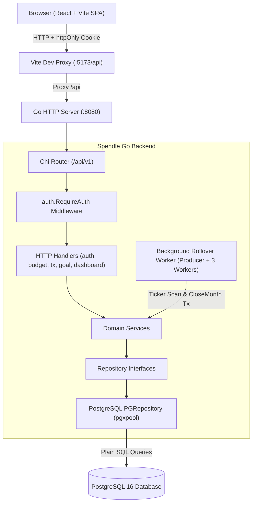
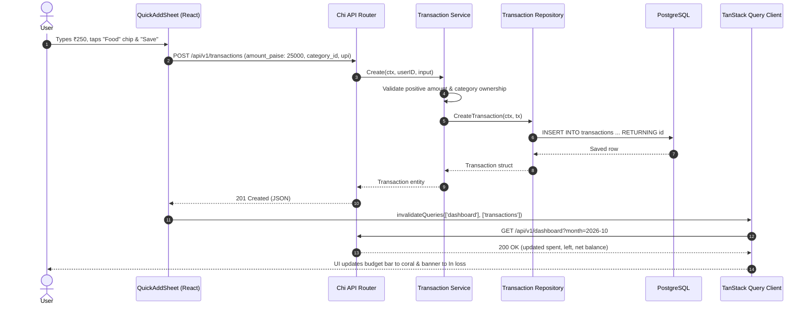

# Spendle

> Personal Budget, Expense Tracking & Automated Savings Rollover Engine

Spendle is an opinionated, privacy-conscious personal finance web application built for college capstone evaluation (New Age Programming Languages Lab). It helps individuals maintain financial discipline through monthly category budgeting, rapid one-tap expense and income logging, and automated month-end rollover sweeps. Unspent budget from previous months is dynamically reallocated into prioritized savings goals via an asynchronous Go background worker, ensuring discipline without manual arithmetic.

```
[ Screenshot: Spendle Dashboard & Quick-Add Sheet (Dark Glass Theme with Molten Gold Accent) ]
```

---

## 1. Features

- **JWT Cookie Authentication**: Secure, constant-time bcrypt authentication using strict `httpOnly`, `SameSite=Lax` session cookies with zero client-side token storage in `localStorage`.
- **Category Budgeting**: Monthly spending limits configured per category, featuring real-time "spent vs. left" tracking with visual progress indicators.
- **One-Tap Quick Logging**: Mobile-first floating action buttons triggering an animated bottom sheet for instant expense/income logging across UPI, Cash, and Card.
- **Prioritized Savings Goals**: Savings targets with priority ranks, dynamic progress percentage, deadline monthly requirement, or estimated time of arrival (ETA).
- **Automated Month-End Sweep**: Background worker goroutine pool that periodically detects unclosed past months and sweeps unspent budget into active savings goals based on priority rank.
- **Idempotent Month Closing**: Atomic PostgreSQL transactions using `ON CONFLICT DO NOTHING` ensuring months cannot be swept twice or duplicate funds transferred.
- **Concurrent Dashboard Aggregator**: Loads monthly summary, category budget progress, and savings goals simultaneously using Go's `errgroup` with a 3-second context timeout.
- **Indian Monetary Standard (INR ₹)**: All financial values are strictly represented and calculated in 64-bit integer paise (`int64`, 1 Rupee = 100 Paise) to avoid floating-point inaccuracies.

---

## 2. Tech Stack

| Layer | Technology | Why Chosen |
| :--- | :--- | :--- |
| **Backend Language** | Go 1.22+ | Native concurrency (goroutines/channels), strong typing, fast execution, zero heavy runtime. |
| **HTTP Router** | Chi (`go-chi/chi/v5`) | Idiomatic, 100% compatible with `net/http`, lightweight composable middleware chain. |
| **Database & Driver** | PostgreSQL 16 + `pgx/v5` | Robust ACID compliance, connection pooling (`pgxpool`), plain SQL without heavy ORM overhead. |
| **Migrations** | `golang-migrate/v4` | Version-controlled, idempotent schema management embedded into the binary via `embed.FS`. |
| **Frontend Framework** | React 18 + Vite | Fast HMR dev-server with built-in proxying, simple JSX without TypeScript build overhead. |
| **Client State / Cache**| TanStack Query v5 | Server-state caching, automatic cache invalidation, and declarative query loading states. |
| **Styling** | Tailwind CSS 3.4 | Utility-first styling with custom tokens (soft dark glass `#0E0E11`, molten gold `#F5B83D`). |
| **Animations** | Framer Motion | Fluid spring physics for the quick-add bottom sheet and modal dialogues (~250ms). |

---

## 3. Architecture

### System Architecture



### Sequence: Quick-Add Expense -> Dashboard Update



---

## 4. Go Language Features Showcase

The codebase is specifically designed for college capstone examination to demonstrate core Go language idioms:

| Go Concept | File & Location | Purpose & Implementation |
| :--- | :--- | :--- |
| **Goroutines & Channels** | [`backend/internal/goal/worker.go`](file:///d:/VsCode/Spendle/backend/internal/goal/worker.go) | Producer enqueues unclosed month jobs into a buffered channel; 3 worker goroutines process rollovers concurrently. |
| **`time.Ticker`** | [`backend/internal/goal/worker.go`](file:///d:/VsCode/Spendle/backend/internal/goal/worker.go) | Triggers periodic background sweeps at configured interval (`WORKER_INTERVAL`). |
| **`sync.WaitGroup`** | [`backend/cmd/api/main.go`](file:///d:/VsCode/Spendle/backend/cmd/api/main.go) | Tracks worker goroutines to ensure all in-flight jobs finish cleanly during shutdown. |
| **Context Cancellation** | [`backend/cmd/api/main.go`](file:///d:/VsCode/Spendle/backend/cmd/api/main.go) | `signal.NotifyContext` intercepts `SIGINT`/`SIGTERM`, propagating cancellation to workers and HTTP server. |
| **`errgroup.WithContext`** | [`backend/internal/dashboard/service.go`](file:///d:/VsCode/Spendle/backend/internal/dashboard/service.go) | Loads summary, budgets, and goals concurrently; aborts siblings on first error. |
| **Consumer Interfaces** | [`backend/internal/dashboard/service.go`](file:///d:/VsCode/Spendle/backend/internal/dashboard/service.go) | Dashboard defines `BudgetsReader`, `SummaryReader`, `GoalsReader` contracts, decoupling from concrete services. |
| **Database Transactions (ACID)** | [`backend/internal/goal/repository_pg.go`](file:///d:/VsCode/Spendle/backend/internal/goal/repository_pg.go) | `tx.Begin(ctx)` wraps closing insertion, leftover calculation, goal balance update, and contributions. |
| **Table-Driven Unit Tests** | [`backend/internal/goal/calc_test.go`](file:///d:/VsCode/Spendle/backend/internal/goal/calc_test.go) | Idiomatic slice of test cases verifying progress percentage capping and deadline arithmetic without DB. |
| **Sentinel Errors & `errors.Is`** | [`backend/internal/goal/errors.go`](file:///d:/VsCode/Spendle/backend/internal/goal/errors.go) | Package-level error values inspected with `errors.Is` in handlers to map clean HTTP status codes. |

---

## 5. Getting Started (Windows PowerShell)

### Prerequisites
- **Go 1.22+**: [golang.org/dl](https://golang.org/dl/)
- **Node.js 18+ & npm**: [nodejs.org](https://nodejs.org/)
- **Docker Desktop**: [docker.com](https://www.docker.com/) (for PostgreSQL)

---

### Step 1: Start PostgreSQL via Docker
Run in PowerShell:
```powershell
docker run -d --name spendle-postgres `
  -e POSTGRES_USER=spendle `
  -e POSTGRES_PASSWORD=spendle `
  -e POSTGRES_DB=spendle_db `
  -p 5432:5432 `
  postgres:16-alpine
```

---

### Step 2: Configure Environment
Copy the example environment file inside `backend/`:
```powershell
cd d:\VsCode\Spendle\backend
Copy-Item .env.example .env
```

---

### Step 3: Seed Demo Data
Populate the database with realistic relative demo data for the presentation:
```powershell
cd d:\VsCode\Spendle\backend
go run ./cmd/seed
```
*Output will display the demo account credentials:*
- **Email:** `demo@spendle.app`
- **Password:** `demo12345`

---

### Step 4: Run Go Backend API Server
In PowerShell Terminal 1:
```powershell
cd d:\VsCode\Spendle\backend
go run ./cmd/api
```
*(Server listens on `http://localhost:8080`, automatically runs database migrations, and starts the background worker pool)*

---

### Step 5: Run React Frontend
In PowerShell Terminal 2:
```powershell
cd d:\VsCode\Spendle\frontend
npm install
npm run dev
```
*(Vite runs on `http://localhost:5173` and proxies `/api` requests to port `8080`)*

---

### Step 6: Log In & Demo
1. Open your browser at `http://localhost:5173`.
2. Sign in with `demo@spendle.app` / `demo12345`.
3. Follow [`docs/DEMO.md`](file:///d:/VsCode/Spendle/docs/DEMO.md) for the live evaluation walkthrough.

---

## 6. Project Structure

```
Spendle/
├── backend/                   # Go REST API backend
│   ├── cmd/
│   │   ├── api/               # Main entrypoint (server + background worker)
│   │   └── seed/              # Database demo data seeder
│   ├── internal/
│   │   ├── auth/              # JWT cookie auth, bcrypt hashing, middleware
│   │   ├── budget/            # Category management & monthly budget limits
│   │   ├── config/            # Environment variable parsing (.env support)
│   │   ├── dashboard/         # Concurrent dashboard aggregator (errgroup)
│   │   ├── db/                # pgxpool connection pool & embedded SQL migrations
│   │   ├── goal/              # Savings goals, rollover sweep, background worker
│   │   ├── httpx/             # JSON response/error encoding helpers
│   │   ├── middleware/        # CORS, structured logger, panic recovery
│   │   └── transaction/       # One-tap expense & income recording
│   ├── go.mod                 # Go module definition
│   └── .env.example           # Backend environment configuration template
├── docs/                      # Capstone evaluation documentation
│   ├── DEMO.md                # 6-8 minute Phase II live demo presentation script
│   └── VIVA_NOTES.md          # Comprehensive viva study notes & examiner Q&A
├── frontend/                  # React 18 + Vite frontend
│   ├── src/
│   │   ├── components/        # GlassCard, ProgressBar, Fab, QuickAddSheet, Modals
│   │   ├── lib/               # Indian Rupee (INR) and calendar date formatters
│   │   ├── pages/             # Login, Dashboard, Goals views
│   │   ├── api.js             # Fetch wrapper with credentials: 'include'
│   │   ├── App.jsx            # Route definitions & auth session guard
│   │   └── main.jsx           # QueryClientProvider & React DOM mount
│   ├── package.json           # Dependencies (Tailwind, Framer Motion, TanStack Query)
│   └── vite.config.js         # Dev-server proxy configuration
└── README.md                  # Project overview, setup, and viva guide
```

---

## 7. API Summary

All endpoints (except health and auth login/signup) are protected by `auth.RequireAuth` checking the `spendle_token` cookie:

| Method | Endpoint | Auth | Purpose |
| :--- | :--- | :---: | :--- |
| `GET` | `/ping`, `/api/v1/health` | No | Public health check and database ping verification |
| `POST` | `/api/v1/auth/signup` | No | Register new account and issue secure session cookie |
| `POST` | `/api/v1/auth/login` | No | Authenticate credentials and issue session cookie |
| `POST` | `/api/v1/auth/logout` | No | Clear session cookie (`MaxAge: -1`) |
| `GET` | `/api/v1/auth/me` | Yes | Get authenticated user profile |
| `GET` | `/api/v1/categories` | Yes | List custom and default categories |
| `POST` | `/api/v1/categories` | Yes | Create a new custom category |
| `DELETE`| `/api/v1/categories/{id}` | Yes | Delete category (cascades or sets null) |
| `GET` | `/api/v1/budgets?month=YYYY-MM` | Yes | Retrieve monthly limits and spent/left progress |
| `PUT` | `/api/v1/budgets` | Yes | Set or update monthly budget for a category |
| `GET` | `/api/v1/transactions?month=YYYY-MM&limit=10`| Yes | List transactions for month (newest first) |
| `POST` | `/api/v1/transactions` | Yes | Record expense (requires category) or income |
| `DELETE`| `/api/v1/transactions/{id}` | Yes | Remove transaction record |
| `GET` | `/api/v1/dashboard?month=YYYY-MM` | Yes | Aggregate monthly summary, budgets, and goals concurrently |
| `GET` | `/api/v1/goals` | Yes | List user savings goals sorted by priority rank |
| `POST` | `/api/v1/goals` | Yes | Create savings goal (by deadline OR monthly amount) |
| `PUT` | `/api/v1/goals/{id}` | Yes | Edit goal details, priority, or status |
| `DELETE`| `/api/v1/goals/{id}` | Yes | Delete savings goal |
| `POST` | `/api/v1/months/close` | Yes | Manually trigger idempotent month-end budget sweep |

---

## 8. Scope & Phase Boundaries

### Included in Phase II (Current Implementation)
- Complete Go backend with Chi, pgx, SQL migrations, and strict user-scoped queries.
- Clean React + Vite SPA with soft editorial dark glass aesthetics and molten gold accent.
- Full authentication lifecycle with secure `httpOnly` JWT cookies.
- Concurrent aggregator using `errgroup` and background rollover worker pool.
- Full Indian Rupee monetary handling in integer paise (`int64`).

### Out of Scope (Planned for Phase III / Future Work)
- Cloud production deployment (AWS/GCP/Railway) and production SSL certificates.
- Recurring automated subscription detection and bill reminders.
- Split expense tracking among multiple users.
- Complex charting libraries (Chart.js / D3.js).
- Password reset emails via SMTP and OAuth2 third-party sign-in.

---

## 9. Academic AI Assistance Statement

In accordance with academic integrity guidelines for this course:
- **Google Antigravity** was utilized as an agentic AI coding assistant for code scaffolding, repetitive boilerplate implementation, and documentation formatting.
- **Claude** was used for high-level architectural brainstorming and query design.
- All generated code, database schemas, concurrency primitives, and architectural decisions were manually reviewed, tested, and validated by the author for adherence to project constraints and Go idiomatic practices.
